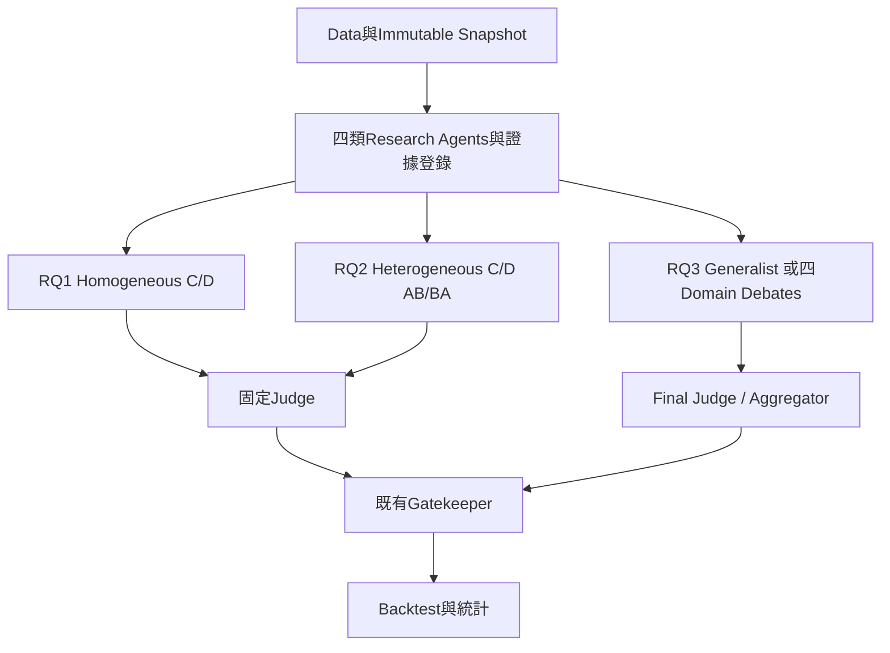

# Part D 完整修改稿

多代理人立場交換辯論機制應用於投資決策：模型異質性與領域專業化之延伸

本稿以原報告逐章保留與修訂，三題新版正式結果均待實驗；舊protocol數字僅列prior result。排版母稿為 application-meeting-20261006.tex。

# 中文摘要

本專題延續多代理人立場交換辯論機制，檢驗在相同案例資料與相同名目決策呼叫次數下，自我反駁流程能否改善投資決策，並檢查模型同質性及資訊處理集中兩項可能限制。系統保留僅含分析日前可得資訊之資料快照、四類研究代理人、證據追蹤、裁決、守門及回測。RQ1 比較固定立場 C 與立場交換 D；D 第二輪須引用並反駁自己第一輪的論點，第三輪回原立場。RQ2 操弄多空代理人的模型組成，平衡模型與原始立場指派，固定 Judge 與 Gatekeeper。RQ3 規劃四領域各自辯論後由 Final Aggregator 整合；辯論規則、呼叫預算與公平比較方式仍待鎖定。研究維持九檔美股、2021--2025 年季度 180 案與 60 交易日，主要指標為方向準確率及年化 Sharpe。

研究結果：【待實驗結果】。三組正式新版實驗尚未完成，舊協議結果另列 prior result；結論將於正式實驗完成後報告。同批樣本的前導使用、模型訓練記憶、選樣與計算資源差異仍限制推論，不預設異質模型或領域分工有效。

 關鍵詞：大型語言模型、多代理人辯論、立場交換、模型異質性、領域專業化、投資決策

# Abstract

 This project retains self-rebuttal role-switching debate as its core investment decision mechanism. Auditable point-in-time snapshots, four research agents, evidence tracing, judging, gatekeeping and backtesting are retained. RQ1 compares fixed-role debate C and role-switching debate D with the same case data and nominal decision calls. In round two, each D agent takes the opposite stance and quotes and rebuts its own first-round claims, before returning to its original stance in round three. RQ2 changes the debater model composition, counterbalances model identities and initial stances, and fixes the Judge and Gatekeeper. RQ3 plans four domain-specific debates followed by a Final Aggregator; debate rules, call budgets and resource comparisons remain to be locked. The scope remains 180 quarterly cases of nine U.S. stocks in 2021--2025, evaluated over 60 trading days using directional accuracy and annualized Sharpe.

 Results: pending formal experiments. All three revised experiments are treated as incomplete. Prior protocol results are reported separately and are not automatically reused as revised formal results. Conclusions will follow completion of the experiments. Prior exposure to this sample, model training memory, purposive sampling and resource differences constrain interpretation; improvements from heterogeneity or specialization are not assumed.

 Keywords: large language models, multi-agent debate, role switching, model heterogeneity, domain specialization, investment decisions

# 引言

## 研究背景

### LLM in Finance

大型語言模型已能閱讀新聞、財報與市場資料，被廣泛用於財報解讀、新聞情緒分析與交易決策 （Lopez-Lira and Tang, 2023；Araci, 2019；Liu et al., 2023）。然而投資決策高度不確定，單一模型直接輸出買賣建議時，可能因證據不足或敘事流暢而過度自信。為提升可靠性，近期研究讓多個模型互相辯論、批評與修正 （Du et al., 2023；Liang et al., 2023），也開始將多代理人架構應用於投資流程 （Xiao et al., 2024；Zhang et al., 2024）。如何設計這類系統、並公平地評估其效果，是金融科技應用的重要課題。

### Multi-Agent Debate 與 Role-Switching

原研究以固定立場辯論 C 與自我反駁式立場交換 D 的比較為核心。D 不只是閱讀對方後模仿反方，而是第二輪只能讀自己的第一輪論述、引用並反駁原主張，第三輪回原立場整合反證。新版從此核心出發，檢查模型組成及任務分工是否改變其效果。

## 研究動機

### 自我反駁機制的增量價值

多代理人辯論的效果仍有爭議：部分研究顯示辯論可提升推理正確性 （Du et al., 2023），但也有研究發現辯論不一定優於多次取樣投票，且效果常被高估 （Smit et al., 2023；Zhang et al., 2025）。辯論的已知問題之一是代理人「固守立場」，只強化自己的論點而不回應反面證據；立場交換被提出以緩解此問題 （Liu et al., 2025；Chowdhury et al., 2026）。截至 2026 年 10 月 5 日，在本文所列文獻及本次核對的 arXiv、OpenReview 與 ACL Anthology 資料範圍內，未見同時以相同案例資訊、對齊名目決策呼叫次數及可稽核時間邊界，直接檢驗自我反駁式立場交換之投資績效的研究。此為本研究搜尋範圍與日期內的觀察，並非系統性回顧或首次研究的主張。此外，金融回測特別容易失真：模型可能記得回測期間的後續走勢 （Glasserman and Lin, 2023；Kong et al., 2026），辯論組也通常比單次判斷多用數倍的模型呼叫。因此，本專題希望在控制這些偏誤的條件下，檢驗立場交換在投資情境是否真的有用。

### 模型同質性與推理差異

Bull 與 Bear 雖有相反角色提示，使用相同基礎模型時仍可能共享知識邊界、推理偏好與錯誤。角色差異不保證有效推理差異；異質模型是否提供互補性仍需檢驗 （Zhang et al., 2025）。不同模型的能力、訓練資料及輸出風格也可能不同，因此模型替換帶來的績效差不能直接歸因於異質性。

### Generalist 資訊集中與領域分工

既有四個研究代理人提供資料整理分工，決策推理仍集中於共同 Bull/Bear。技術、基本、新聞情緒與總經證據的時間尺度及訊號型態不同，合併後可能壓縮特定領域反證或增加 context 負擔。此為研究假說，不是已由舊負面結果證實的原因。RQ3 將分工延伸至領域內多空論證，再由上層整合，評估收益、衝突與資源負擔。

## 研究目的

### 立場交換機制

檢驗自我反駁式立場交換相對固定立場辯論的增量價值，維持原核心問題。

### 模型異質性

檢驗同一辯論內的模型組成是否改變 D 相對 C 的效果，區分角色差異與模型差異。

### 領域專業化

檢驗領域內辯論及上層整合相對 Generalist 的績效與成本，評估任務分解的價值。

## Research Questions

### RQ1 原始機制

> 在相同案例資料與相同名目決策呼叫次數下，自我反駁式立場交換辯論（D）的 60 日方向準確率與年化 Sharpe 是否高於固定立場辯論（C）？

### RQ2 Model Heterogeneity

> 當看多與看空代理人由不同基礎模型擔任時，自我反駁式立場交換辯論（D）相對固定立場辯論（C）的投資決策效果是否改變？

### RQ3 Domain-Specialized Debate

> 相較於將四類金融資訊整合後交由共同多空代理人辯論，若改由技術面、基本面、情緒面與總經面代理人分別在各自資訊領域進行多空辯論，再由上層整合機制形成最終投資決策，是否能改善方向準確率與風險調整後績效？

三題構成機制、模型組成與任務分工的連續研究，但 RQ2/RQ3 不是必須等待 RQ1 不顯著才執行的事後補救。三題正式新版實驗均尚待執行；舊 RQ1 是否沿用須先核對身分與規則並由研究者確認。

## 研究範圍

### 樣本與資料時間邊界

本專題定位為投資決策輔助之研究與系統原型，不是自動交易系統，範圍如表 〔tab:scope〕。

**研究範圍**

| 面向 | 範圍說明 |
| --- | --- |
| 標的與期間 | 九檔美國大型股，2021 至 2025 年每季一個分析日，共 180 個案例 |
| 資料 | 技術面、基本面、情緒面（新聞標題）與總經面，僅使用分析日前已公開之資料 |
| 決策輸出 | 買進、持有或賣出，以及預期報酬、信心度、理由、引用證據與風險 |
| 評估 | 60 個交易日之方向準確率與 Sharpe 比率；30 與 90 日為穩健性檢查 |
| 模型 | RQ1 基準模型、RQ2 Model A/B 與固定 Judge 正式實驗前待鎖定；qwen3:32b 為既有執行模型 |

### 預測期間與決策層

維持九股、20 季末、180 個 stock $×$ date cases、60 trading days。C/D 候選裁決沿用 Buy/Sell，Gatekeeper 可降為 Hold 或不交易；A/B 允許 Hold，僅作補充對照。主要分析沿用候選決策層，守門後實際風險處理另列敏感性。原月度／20 日比較移至未來展望，不任意替換正式樣本。

# 文獻探討

## Multi-Agent Debate

### 辯論與自我一致性的公平對照

（Du et al., 2023） 讓多個模型實例進行多輪辯論後收斂答案，改善推理與事實正確性；（Liang et al., 2023） 指出模型自我反思容易固守既有答案，並以辯論鼓勵發散思考。另一方面，（Smit et al., 2023） 比較多種辯論策略，顯示多代理人辯論不一定穩定優於自我一致性等其他方法，且對設定敏感；（Zhang et al., 2025） 主張目前的評估常高估辯論，呼籲重新思考評估方式並採用異質模型。自我一致性 （Wang et al., 2023） 以多次取樣投票提升穩定性，是比較辯論效果時必要的對照組，本研究的獨立投票組即據此設計。由此，本研究把重點放在可追蹤的流程與公平比較（呼叫次數對齊），而不是預設辯論一定比較準。

## Role-Switching / Self-Rebuttal

### 機制假說與失效條件

（Liu et al., 2025） 提出不確定性感知的角色交換辯論：兩個辯論者先給出初始答案並互相詰問，再於辯論中途交換角色論證相反立場，然後各自回報信心與不確定性，最後由另一個裁判模型裁決；在 OpenBookQA 上，其消融實驗顯示角色交換與不確定性回報兩個階段均有貢獻。（Chowdhury et al., 2026） 的 PROCLAIM 以法庭角色（原告、辯護、法官）與漸進式檢索進行主張查核，並以角色交換作為一致性診斷；其消融結果顯示角色交換帶來約 4.2 個百分點的準確率提升，但整體 token 用量約為標準多代理人辯論的 11 倍。（Chen et al., 2026） 的多人格思考以相反的人格與中立觀點反覆對話，使偏誤外顯並被修正。這些研究支持「從相反立場重新思考」的想法，但皆非投資決策，且第二項的效益是伴隨成本增加而來，凸顯呼叫預算對齊的必要。本研究因此採用看多、看空與裁決者的三角架構，並讓獨立投票與兩辯論組之決策呼叫次數對齊（單次判斷為基準）。
**機制動機與可能失效的條件。** 
（Lord et al., 1984） 的人類社會判斷實驗指出，考慮與既有信念相反的可能性可減少特定判斷偏誤。本研究據此提出機制假說：要求代理人引用並反駁自己的論點，可能暴露先前忽略的反證，改善裁決對證據的權衡。此推論從人類判斷延伸至 LLM 金融預測，尚須實證檢驗；論述更完整不必然代表未來報酬預測更準確。（Huang et al., 2024） 發現，缺乏外部回饋的內生自我修正，在其推理基準上可能無效甚至降低表現；若模型共享相同錯誤、輸入資訊缺乏預測訊號，或市場噪音主導結果，自我反駁也可能只改變敘事而無績效增益。

## Model Heterogeneity in Multi-Agent Systems

### 異質性、能力組成與模型偏向

（Zhang et al., 2025） 對多代理人辯論評估與模型異質性提出檢驗，提供不同底層模型共同推理的研究動機。其基準結果不能直接外推到金融未來報酬或本研究自我反駁規則。RQ2 將同一辯論內 A/B 共存與整套系統換成 B 區分；後者仍是 homogeneous setting。模型能力、偏向、Judge 親和與錯誤相關性須分別診斷。

【需補文獻】異質模型辯論的能力匹配對照、錯誤互補與模型偏向量測，以及在共同金融資料下對機制交互作用的識別。未宣稱已完成全面文獻搜尋。

## Financial LLM and Investment Agents

### 金融語言與代理人工作流

（Lopez-Lira and Tang, 2023） 在其樣本與設定中發現，LLM 對金融新聞標題的判讀含有與後續報酬相關的訊息；FinBERT （Araci, 2019） 與 FinGPT （Liu et al., 2023） 提供金融語言處理方法，FNSPID （Dong et al., 2024） 則提供具時間戳記的新聞資料。這些工作說明資訊整理的可能用途，但不能直接推得任何辯論流程有增量價值。

TradingAgents （Xiao et al., 2024） 與 StockAgent （Zhang et al., 2024） 將 LLM 分工與交易決策置於回測或模擬環境；其研究對象包含整套代理人系統，與本研究控制案例輸入後比較 D、C 的估計量不同。（Glasserman and Lin, 2023） 的前視風險分析，以及 （Huang et al., 2024） 對無外部回饋自我修正的審慎結果，均提醒：流暢推理與模擬績效不能單獨證明可用的未來預測訊號。本研究的缺口因而限定為：在名目呼叫次數對齊、資料時間邊界可稽核的設定下，重新檢查既有證據的自我反駁流程是否改善方向與風險調整績效，而非僅將既有辯論方法搬至金融領域。

## Domain Specialization / Task Decomposition

### 摘要分工與決策分工的區分

TradingAgents 與 StockAgent 提供金融代理人工作流的既有脈絡 （Xiao et al., 2024；Zhang et al., 2024）。資訊摘要分工、策略角色分工與四個資料領域各自執行多空辯論並不相同；不能以既有專業分析師模組直接證明新版 RQ3 的效果。領域切分可能保留局部反證，也可能失去跨領域脈絡或增加整合錯誤，兩者均須評估。

【需補文獻】直接比較 Generalist 與領域內辯論的研究、task decomposition 的資訊損失／資源公平、cross-domain aggregation 與 context 負荷。此處是待檢驗設計，不以「首次提出」界定貢獻。

## Look-Ahead Bias and Financial Evaluation

### 資料時間邊界與模型訓練記憶

（Glasserman and Lin, 2023） 指出以 GPT 產生之情緒訊號預測報酬時，模型可能透過對公司的既有知識引入前視偏差，並嘗試以匿名化緩解；（Kong et al., 2026） 歸納金融 LLM 常見的五種偏誤（前視、存活、敘事、目標與成本偏誤），並指出多數研究未明確處理。本研究因而在資料端嚴格排除分析日以後的資訊，以舊協議的無資料回想與匿名辨識探針作前導風險診斷（舊協議前導診斷小節），並在回測中扣除交易成本。探針並非新版主樣本的完整汙染檢驗。

## Literature Synthesis / Research Gap

### 機制、模型與任務的連續問題

本研究承接辯論、自我一致性、角色交換、金融語言處理與前視偏差文獻，從固定案例資料下自我反駁有無增量價值出發，再檢驗指定模型組成與領域分工是否改變決策。原文獻不足以證明同質性或資訊負荷已導致舊結果失效；新版三題提供可稽核比較，而不預设任何架構必然較佳。文獻中的問答正確性、事實查核與投資報酬預測端點不同，不能直接等同。原自我一致性、角色交換與負面結果來源皆保留。

# 研究方法

## 研究架構

### 共同資料層與三個實驗分支

既有 Coordinator、Data Snapshot 與四類 Research Agents 保留。共同資料層產生不含投資方向的鎖定研究資料與證據登錄。RQ1/RQ2 讀取同一 Neutral Report；RQ3 Generalist 仍讀整合報告，Domain 分支使用相同研究輸出的領域切片，不另抓新資料或以不同摘要模型重製輸入。概念架構如下，新增分支尚待實作驗證。

新版研究概念架構。三分支以共同資料、候選決策及評估口徑銜接；RQ3 的規則與資源預算尚未鎖定。

### Judge 與 Gatekeeper

Judge 綜合辯論、核對證據並形成投資方向。Final Aggregator 是 RQ3 整合四個 Domain Views 的上層裁決者，不再額外假設其後需要另一個決策 Judge。Gatekeeper 在投資方向形成後檢查引用、coverage、volatility、risk threshold、基準率歷史並必要時降級；它不承擔四領域投資觀點整合。

## 資料收集

### 四類資料與時間控制

樣本為九檔美國大型股（AAPL、 NVDA、 GOOGL、 MSFT、 AMZN、 JPM、 MCD、 INTC、 GE），分析日為 2021 至 2025 年共 20 個季末。每個案例只使用分析日前已公開之資料（表 〔tab:data〕）：財報依申報日而非會計期末篩選，總經資料使用當時實際已發布之歷史版本，資料快照以內容雜湊識別，四組決策讀取同一份快照。

**資料來源與處理方式**

| 面向 | 來源 | 內容與處理 |
| --- | --- | --- |
| 技術面 | 調整後日行情 | 近 20 日報酬、均線相對位置、年化波動度；僅用分析日前價格 |
| 基本面 | SEC 財報 | 營收、淨利、營業現金流與去年同期比較；依申報日篩選 |
| 情緒面 | 金融新聞標題（FNSPID、Alpha Vantage） | 分析日前 90 天全部標題，舊版資料統計為 83,093 則，新版凍結數量待核對，以 FinBERT 逐則評分後彙整 |
| 總經面 | FRED／ALFRED | 失業率、利率、物價等，僅採分析日當時已發布之數值 |

九檔的選取以資料可取得性為主，非 2021 年成分股抽樣；協議記錄排除缺乏新聞覆蓋的 ASTS，並以 INTC 替換有早期新聞缺口的 LLY。原分析排除 37 案的新聞診斷集合尚未附逐案名單；它與 36 個僅有 API 標題案例及 MCD 2023-12-31 案的重疊關係、排除規則仍待新版快照核對，不宣稱已定義統一則數門檻。

### 資料品質與版本風險

為確保快照僅反映分析日當時可得之資訊，本研究採取三項處理：其一，財報依申報日期而非會計期末篩選，並以相同會計科目、相同期間長度與前一年同期比較，避免混用不同期間；其二，年增率以前期絕對值為分母，使負數基期惡化時呈現負值，避免符號誤導；其三，快照以內容雜湊為識別碼，同一模型同一案例內的四組決策機制讀取同一份快照與鎖定報告。行情使用 yfinance 的 auto_adjust=True；調整係數反映下載時可得之拆股與股利處理，並非各分析日保存的調整版本，仍有事後修訂風險。
新聞依發布 timestamp 與時區篩選，財報以 filing date 判定實際可得，macro 以分析日已發布的 historical vintage 建立；價格輸入只使用 cutoff 以前。每案記錄 data version、snapshot hash、evidence ID、code version、model version 與 audit trail。同案跨條件共用快照不能單獨證明資料內容正確，須驗證可用時間與来源。舊版 FinBERT revision、37案新聞排除集合與調整行情下載版本均仍待核對，不因新版 RQ 改變而取消揭露。

## 實驗設計

### Common Experimental Setup

共同使用固定案例、快照、outcome 與回測。研究代理人模型、輸出與 Neutral Report 凍結，避免 RQ2 更換辯論者時同時改變資訊摘要。C/D 的 Judge、Gatekeeper、溫度與名目輪次對齊；呼叫種子依版本化規則保存。原 qwen 溫度0.2、基礎seed905、context8192、輸出2048與投票溫度0.8為舊協議執行紀錄，新版是否沿用須重新鎖定，不能跨模型假設種子必然有效。

原三輪C/D各七次名目決策呼叫可沿用，另記實際成功、失敗、retry calls及輸入／輸出tokens。記憶僅含分析日前已到期同股案例；其來源、各分支可見範圍與更新政策必須相同且正式前凍結。若各組累積各自的歷史決策，須承認後續輸入受先前處理影響，估計為動態整套流程效果。正式批次不得讀試跑結果，執行順序、模型service drift、截斷規則與失敗處置亦需記錄。

### Fixed-role Debate C

C 的 Bull/Bear 三輪維持原始立場，每輪各一次呼叫，依原資訊可見規則批評與整合，再交固定 Judge，名目共七次。A 單次判斷、B 七次獨立投票僅供補充。下表保留既有流程，不代表新版三題已完成。

**四組決策機制。**  B、C、D 三組之決策呼叫次數對齊（各 7 次），A 為單次判斷之基準（表 〔tab:arms〕）；此為名目呼叫數，D 的引用自身原文驗證可能另觸發重試；呼叫次數相同不代表實際重試次數、token 或運算量相同，辯論組因讀取歷史論述，輸入較長。每次決策輸出買進（做多）、持有（不進場）或賣出（放空），以及 60 個交易日之預期報酬、信心度、理由與引用證據。

**四組決策機制**

| 組別 | 名稱 | 呼叫次數 | 流程 |
| --- | --- | --- | --- |
| A | 單次判斷 | 1 | 讀取報告後直接決策 |
| B | 獨立投票 | 7 | 同一提示獨立取樣七次，多數決 |
| C | 固定立場辯論 | 7 | 看多與看空辯論三輪（每輪可見雙方論述），再由裁決者決策 |
| D | 立場交換辯論 | 7 | 第二輪交換立場、只見自己第一輪並須反駁之，第三輪換回，再由裁決者決策 |

### Role-Switching Debate D

**比較量。**  本專題估計整套 D 對 C 的複合流程效果差（composite-protocol estimand），包含立場交換、交換輪隔離對手、強制引用與相應驗證／重試。未以消融分離各要素，故不能歸因於單獨的立場交換。

**立場交換辯論。**  表 〔tab:rounds〕 為立場交換組之三輪流程。第二輪隔離對手論述是刻意設計：若同時看得到對手，代理人容易轉為回應對手，而非檢討自己的主張。辯論組之裁決者須逐項核對雙方引用之證據，並綜合雙方論點在買進與賣出之間擇一。

**立場交換辯論之三輪流程**

| 輪次 | 內容 | 目的 |
| --- | --- | --- |
| 第 1 輪 | 看多與看空代理人各自提出論點並引用證據 | 建立正反兩方初始立場 |
| 第 2 輪 | 雙方交換立場，只能看到自己第一輪之論述，須引用並反駁自己的原主張 | 迫使代理人檢驗自身論點之弱點 |
| 第 3 輪 | 雙方換回原立場，整合前兩輪之論點與反駁 | 產生整合後之論點與不確定性揭露 |
| 裁決 | 讀取完整辯論與報告，逐項核對證據後擇一方向 | 避免以辯論聲量決定 |

Model identity 在三輪固定：只有 stance 在第二輪反轉、第三輪回復。強制引用自己第一輪原文的驗證規則與重試屬處理的一部分，正式前保存 validator hash。現有原文核對採至少70%字詞連續相同；這只檢查引用來源，不能證明反駁語意有效。

### RQ1 Design

在相同案例資料與相同名目決策呼叫次數下，自我反駁式立場交換辯論（D）的 60 日方向準確率與年化 Sharpe 是否高於固定立場辯論（C）？

RQ1 維持同質辯論者、同資料與七次名目決策呼叫，估計整套D相對C的方向準確率及Sharpe差。單次判斷及獨立投票不取代核心對照。下述舊偏誤控制敘述屬既有protocol紀錄，新版登記與身分核對尚待完成；即使舊RQ1文字相同，也不得自行升格舊結果。

**偏誤控制。**  股票代號與公司名稱於模型輸入中匿名化，降低模型憑記憶辨識標的之可能；180 個案例與分析計畫於執行前事前登記，程式與模型版本於登記時鎖定，確保全部案例在同一規則下產生；主要檢定事先指定，避免事後挑選有利的期間或方法。惟同批樣本曾用於前導研究與流程試跑，因此結果屬鎖定規則後對既有樣本之回溯比較，不視為全新之樣本外驗證。

### RQ2 Heterogeneous Model Design

RQ2 主要操弄多空辯論者的模型組成；固定 case、snapshot、Neutral Report、Research Agents、三輪、Role-Switching rule、Judge、Gatekeeper、outcome與backtest。Homogeneous為A/A；Heterogeneous有兩個平衡配置：AB（原Bull=A、原Bear=B）與BA（原Bull=B、原Bear=A）。兩個配置均需有C與D，不讓A永遠是Bull。

**異質D的身份與立場，model identity不交換**

| 輪次 | AB配置 | BA配置 |
| --- | --- | --- |
| Round 1 | A Bull；B Bear | B Bull；A Bear |
| Round 2 | A Bear；B Bull | B Bear；A Bull |
| Round 3 | A Bull；B Bear | B Bull；A Bear |

正式實驗前待鎖定：Model A/B、Judge model及版本、各模型prompt與生成參數、AB/BA指派與匯總方式。建議每案執行AB/BA以檢查模型偏向，但不自動決定實驗量；兩配置共享同一案例與outcome，不是360個獨立案例。單次隨機平衡分派亦須事前登記。

主要比較為C_hetero與D_hetero，再與C_homo/D_homo之差比較。A/A對A/B同時改變能力組成；建議另考慮B/B對照，尚未納入正式必跑條件。即使加入B/B，也不能宣稱完全分離能力、互補性與家族差異。固定Judge也可能偏好某模型文風；模型標籤盲化、輸入順序及context上限須控制。不要同時替換Judge、Gatekeeper或研究摘要模型。

### RQ3 Domain-Specialized Design

Generalist使用同一四類整合研究報告，由共同Bull/Bear辯論。Domain架構從同一鎖定四類研究輸出分流：Technical Bull/Bear形成Technical View；Fundamental Bull/Bear形成Fundamental View；Sentiment Bull/Bear形成Sentiment View；Macro Bull/Bear形成Macro View。四個Views送Final Judge/Aggregator，再經既有Gatekeeper與同一Backtest。每領域必須有多空論證與交互檢查，不以四份摘要替代辯論。

局部代理人使用其領域相同快照的證據切片，禁止偷用其他領域資料；同一資訊在領域間的歸屬與共享背景規則須先定義。各域View均针对同一60交易日投資方向；短期證據不是改用20日outcome。模型組成、裁決層、記憶、輸出與風險規則盡量控制。若domain採D而generalist採C，效果同時混入分工與switching，不可稱純分工效果。

- 各Domain採Fixed only、Role-Switching only或兩者皆跑：正式實驗前待鎖定。

- 各Domain nominal call budget、View生成與Aggregator是否另計呼叫、重試上限：正式實驗前待鎖定。

- 與Generalist比較的decision calls、tokens、compute cost與latency如何匹配或呈現：正式實驗前待鎖定。

- Final Judge input schema（Views、原證據、transcripts、記憶、順序及長度）：正式實驗前待鎖定。

- Domain View standardized output schema（stance、confidence、evidence、counter-evidence、uncertainty、missingness等候選欄位）：正式實驗前待鎖定，候選欄位不是已定schema。

可以提出固定預算比較、同輪次但不同資源的整體架構比較或成本效益前緣作選項，目前尚未選定。四組辯論可能增加compute，應報所有研究、辯論、View生成、Aggregator與retry成本，不能只數Final Judge。四領域分歧4:0、3:1、2:2僅適用四個有效二元方向；缺失或棄權需另列。

### Evaluation

以下保留原RQ1評估定義與計算參數，作新版沿用基礎；參數與code版本仍須正式前確認，不代表已完成新版評估。

**評估方法。**  於分析日後第一個交易日開盤進場、持有 60 個交易日後開盤出場，並扣除 Corwin--Schultz 估計之買賣價差成本 （Corwin and Schultz, 2012）。主要比較為 D 對 C，兩個共同主要指標為方向準確率（配對 McNemar 檢定 （McNemar, 1947））與年化 Sharpe 比率差（Ledoit--Wolf 檢定 （Ledoit and Wolf, 2008）），以 Holm 法 （Holm, 1979） 校正；沿用雙尾檢定，僅當兩端點差異皆為正且各自校正後 $p<0.05$ 才判定 D 較佳。30 與 90 日、不計成本、排除低新聞量案例及以日期為群聚之信賴區間為敏感性分析。

日報酬先依每案進場開盤、每日收盤與出場開盤之部位權益計算，扣除進出場價差；同日期各案固定權重 1/180，持有與非交易期間為零。年化 Sharpe 為 $√{252}\bar r/s(r)$，其中案例數 $n_{\mathrm{case}}=180$，分析日群聚數為 20，$T$ 為對齊日面板的交易日筆數（實際值尚未核對），不可互換；標準差採 $T-1$ 分母，無風險基準明設為零。累積報酬為 $\prod_t(1+r_t)-1$，非平均 60 日案例報酬；最大回撤亦由此日序列計算，此低曝險配置僅供組間比較。方向正確依未扣成本的開盤價格漲跌判定，與淨報酬正負不同。Ledoit--Wolf 區塊長度 20 日、每次重抽樣長度 $20\lfloor T/20\rfloor$、重抽樣 1,999 次、種子 905；qwen 基礎推理種子 905、溫度 0.2（投票 0.8），各呼叫實際種子另保存於稽核。

Secondary metrics包含cumulative return、maximum drawdown、decision distribution、confidence、transaction-cost adjusted return與disagreement。RQ2另報Bull/Bear分歧、模型決策差與model-specific bullish/bearish bias；RQ3報四域stance、一致程度與跨領域衝突的處理。分歧增加、引用更完整或更常看空均不直接代表績效改善；confidence是自報值，不自動視為校準機率。候選層與守門後層分開報coverage、条件accuracy及日報酬，無風險基準零与低曝險配置亦須揭露。

### Statistical Analysis

RQ1沿用配對McNemar、Ledoit--Wolf／區塊bootstrap、雙尾檢定、共同兩端點Holm及日期群聚敏感性；兩端點差皆為正且校正後顯著才支持優越性。樣本共享20個日期、股票反覆出現與重疊持有期，獨立性假設须以群聚/區塊方法檢查；日期群聚數有限，不把敏感性當成充分校正證明。未顯著不等於等效或非劣，等效界值不能看結果後補訂。

RQ2首先於事先指定指派單位比較D_hetero與C_hetero。是否再估計$(\mathrm{Acc}_{D,h}-\mathrm{Acc}_{C,h})-(\mathrm{Acc}_{D,a}-\mathrm{Acc}_{C,a})$之交互差，僅提出共同案例/日期區塊重抽樣或配對交互模型的建議，正式前待鎖定。此為實驗因素比較，不直接套用觀察研究的DID。不能由一邊顯著而另一邊不顯著推論交互作用。AB/BA平均後正確性非二元，不可直接普通McNemar；Sharpe须重新計算配對日序列，不能平均兩個Sharpe或拼接成雙倍T。

RQ3待domain rule、call budget與output unit鎖定後，才選定配對accuracy與策略日序列檢定；可沿用同case配對与日期區塊方法作候選，不預先确定最终統計方案。各領域不是四个獨立金融案例。三題比較、多端點与diagnostics的檢定family、Holm範圍與探索分析標籤須一併登記；RQ1原兩端點校正不自動處理全部新增檢定。失敗、缺失、排除與重跑規則均須看結果前凍結。

## 工具及設備

### 既有工具鏈與 GPU

**工具及設備**

| 項目 | 工具 | 用途 |
| --- | --- | --- |
| 程式語言與框架 | Python、FastAPI | 後端服務與網頁介面 |
| 流程控制 | LangGraph | 管理研究、決策、風控與回測之狀態流程 |
| 模型呼叫 | Ollama、LiteLLM | 既有部署開源模型 qwen3:32b；新版模型待鎖定，並統一呼叫介面 |
| 資料來源 | yfinance、 SEC EDGAR、 FRED／ALFRED、 FNSPID、 Alpha Vantage | 行情、財報、總經與新聞 |
| 情緒分析 | FinBERT | 新聞標題之正負面評分 |
| 儲存與部署 | SQLite、Docker | 保存案例與實驗紀錄、容器化部署 |
| 運算資源 | 雲端 GPU 主機 | 執行模型推理 |

# 系統設計與實作

## 系統架構

### 既有流程與新增模組狀態

系統由協調者控制任務、資料邊界與記憶權限，使四組決策機制只在研究報告鎖定之後才分流（圖 〔fig:flow〕）。所有模組共用同一個資料庫與流程引擎，網頁介面、命令列與程式介面三種操作方式皆呼叫相同流程，確保實驗結果與操作方式無關。
上述是既有系統；新版將從共同research outputs分至三題分支。下述Model Router、Domain Debate Module與Final Aggregator為新增設計需求，尚未由本次文件修訂完成實作或驗證；不將概念圖當執行證據。

## 功能模組

### Coordinator 與 Data Snapshot

協調者固定案例、protocol、cutoff與模型設定，資料代理人建立不可變快照，內容hash與evidence ID連結執行紀錄。

### Research Agents

四面向研究代理人各自摘要與引用同一時間邊界內證據，產生鎖定Neutral Report與領域輸出；驗證失敗時的來源摘錄降級亦記錄。

### Short-term Memory / Long-term Memory

短期紀錄保留每次prompt hash、種子、用量、辯論與裁決；長期記憶只讀分析日前已到期同股案例。舊C/D Judge可讀長期記憶、A/B不可；新版各分支的來源與權限待固定，禁止未來outcome寫回後被過去案例讀取。

### Judge / Gatekeeper / Backtest

Judge逐項核對論點與證據後輸出候選方向；Gatekeeper檢查引用、coverage、volatility與基準率歷史，必要時降級。Backtest計算相同開盤進出、成本與日序列，不把四域View當四個部位。

### Model Router

新增待實作：保存agent identity、初始stance、round stance與model ID/version，按AB/BA配置呼叫不同模型；第二輪只改stance，引用仍指向同agent第一輪。禁止fallback靜默改模型，API seed支援與provider drift需記錄。

### Domain Debate Module

新增待實作：將同一快照的領域證據分流給各域Bull/Bear，執行尚待鎖定的Fixed或Switch規則，保存domain transcripts與Domain Views。證據namespace與可讀權限须驗證。

### Final Aggregator

新增待實作：按待鎖定schema讀取四個Views，評估衝突、反證與缺資料，輸出一個最終候選決策；其prompt、輸入順序與記憶須版本化，之後仍進相同Gatekeeper。

## 介面設計

### 既有研究台與新版分支規劃

介面設計以「流程可視化」與「步驟引導」為原則：頁面上方的資料流向圖（圖 〔fig:ui〕）即時顯示每個案例從資料來源、研究代理人、中立報告、四組決策到風控與回測的進度，點選任一節點即可檢視該步驟之輸入、模型輸出與紀錄；下方依「資料準備、建立實驗、代理人執行、統計結果」四個步驟分頁，使用者可依序完成一次完整實驗，並即時查看執行終端與工作佇列。

網頁介面之資料流向圖（一個已完成案例）。由左至右為資料來源、資料代理人、資料快照、研究代理人、中立報告、四組決策、守門員、回測與統計。

此圖為既有介面，不代表新增模組已上線。後續需呈現model assignment、domain debates、四Views、Aggregator、名目與實際資源紀錄；新版介面實作狀態仍待驗證。

## 實作流程與驗證

### 既有開發流程

系統依「資料、研究、決策、回測、統計」之順序逐步開發，每完成一個模組即以合成資料與小樣本測試，再以少量真實案例試跑後才進行正式實驗。開發過程中的主要挑戰與對策如下：

  
- 時間邊界：財報與新聞須以「可取得時間」篩選，避免分析日後的資訊進入輸入；總經資料改用歷史版本以排除事後修正。
  
- 模型輸出不穩定：模型常引用不存在的證據或格式錯誤，以結構化輸出、證據短代稱與自動重試處理；模型也常自行改寫數字，改為要求以證據代稱指稱事實。
  
- 結果可重現：實驗跨越多天執行，系統於事前登記時鎖定程式與模型版本，每一步推理前後核對模型權重，版本不符即拒絕執行。
  
- 長時間執行：網路中斷時自動暫停並於恢復後續跑，已完成之步驟不重新產生，確保 180 個案例在一致條件下完成。

### Audit Trail 與版本核對

為使每個決策可回溯，模型輸出寫入前皆經驗證，且每次呼叫皆留下稽核紀錄：

  
- 提示詞中之證據以短代稱（E1、E2、$…$）呈現，回答後由程式對映回真實識別碼，避免模型抄寫長識別碼出錯，同時不使識別碼中之申報編號洩漏公司身分。
  
- 引用之證據必須存在；引用不存在之證據或格式錯誤時，以明確訊息要求重試，最多三次。
  
- 數字檢查：新版要求代理人以證據代稱指稱事實、不重述數字；敘述中仍出現之數字若無任何證據數值支持（期間名稱、日期、來源值之四捨五入或截位不計），僅記錄並依組別報告比例，不重試、不修改文字。
  
- 凍結與身分核對：每一步推理前後皆核對模型權重之 digest，無法取得時暫停並可續跑，確認不同時則該案永久作廢；程式原始碼之雜湊納入協議雜湊，改動即拒絕續跑。連線故障連續發生時暫停派發新案例，並於停滯過久時自動關閉 GPU 主機。
  
- 每個案例可匯出完整紀錄：協議設定、中立報告、證據登錄、執行軌跡、記憶、決策、逐案例回測與彙總指標，以及辯論逐字稿。

## Implementation Challenges

### 異質格式與 context handling

不同模型的structured output、tokenizer與context能力不同，轉接器不能加入額外金融訊息或默默截去某方反證。需统一輸出契約、保存raw response與截斷紀錄，約束輸入長度並記錄失敗。

### 資源公平與 domain output normalization

相同calls不等於相同tokens、成本或latency；平行四域還有wall-clock與累計推理時間之差。Views長度、缺失值、證據與反證欄位標準化會影響上層裁決，schema與prompt必須先鎖定，不能依事後績效調權重。

### 模型能力混淆

Router能指定異質模型不代表能隔離異質性效果。需解釋能力組成、Judge文風偏好與不同訓練記憶風險；B/B控制、盲化及重跑僅是待採的研究建議，不假稱已驗證。

# 結果與討論

新版三組正式實驗尚未完成。前三節全部為結果框架，第四、五節是舊協議紀錄，不自動納入新版正式推論。

## RQ1 Results

### C vs D 主要端點與敏感性

| 指標 | C | D | 差與CI／校正p |
| --- | --- | --- | --- |
| 60日方向準確率 | 【待實驗結果】 | 【待實驗結果】 | 【待實驗結果】 |
| 年化Sharpe | 【待實驗結果】 | 【待實驗結果】 | 【待實驗結果】 |

【待實驗結果】完成後依預先指定共同端點回答RQ1，報candidate/post-gate、coverage、配對案例、方向分歧數、return、drawdown、成本與日期群聚區間；負面或不確定結果仍報告。

## RQ2 Results

### Homogeneous / Heterogeneous C/D 效果

| 模型配置 | C績效 | D績效 | D−C |
| --- | --- | --- | --- |
| A/A | 【待實驗結果】 | 【待實驗結果】 | 【待實驗結果】 |
| AB | 【待實驗結果】 | 【待實驗結果】 | 【待實驗結果】 |
| BA | 【待實驗結果】 | 【待實驗結果】 | 【待實驗結果】 |

【待實驗結果】依正式前鎖定的配置匯總與統計方法呈現accuracy與Sharpe；若採B/B另行列出。交互作用僅在事前指定後檢定，不以兩組p值大小比較推論效果改變。

### Counterbalancing 與模型偏向診斷

【待實驗結果】分原stance及model identity呈現分歧、bullish/bearish bias、AB/BA一致性、呼叫失敗及tokens；分歧增加不等於績效改善。

## RQ3 Results

### Generalist / Domain-specialized 績效與成本

| 架構 | Accuracy／Sharpe | Return／Drawdown | 資源與延遲 |
| --- | --- | --- | --- |
| Generalist | 【待實驗結果】 | 【待實驗結果】 | 【待實驗結果】 |
| Domain-specialized | 【待實驗結果】 | 【待實驗結果】 | 【待實驗結果】 |

【待實驗結果】正式比較對應相同debate rule及已鎖定公平預算；若未匹配compute，僅描述整套架構與成本效益，不將增益歸因純分工。

### Domain stance 與衝突整合

【待實驗結果】報Technical、Fundamental、Sentiment、Macro stance與4:0／3:1／2:2分布，缺失或abstain另列。追蹤Final Judge對跨域證據衝突之處理；規則若看結果後調整，另標探索性。

## 舊協議 Prior Results

本節所有數字、檢定及案例均為舊協議prior result，尚未經研究者確認可列新版正式Results。下列沿用原報告的完成敘述只指既有qwen季度protocol，不表示新版三組實驗完成。本次未重新核對raw outputs或重算表格。保留負面結果、原表註及case描述，避免因改題消失。

### 舊 qwen 績效與檢定

180 個事前登記案例全數完成，無排除案例。表 〔tab:main〕 為四組之績效，表 〔tab:tests〕 為配對檢定。

**四組績效（180 案，60 個交易日，扣除交易成本）**

| 組別 | 出手率 | 條件準確率 | 累積報酬 | 最大回撤 | 年化 Sharpe |
| --- | --- | --- | --- | --- | --- |
| A 單次判斷 | 78.3% | 56.0% | 1.85% | $-1.81\%$ | 0.44 |
| B 獨立投票 | 79.4% | 55.9% | 1.95% | $-1.83\%$ | 0.46 |
| C 固定立場辯論 | 100% | 58.3% | 2.51% | $-1.47\%$ | 0.59 |
| D 立場交換辯論 | 100% | 55.0% | 2.11% | $-2.01\%$ | 0.54 |
| 買進持有（同案同期間） | -- | -- | 5.60% | $-1.59\%$ | 1.01 |

決策為守門員之前之候選決策。出手率為買進或賣出（非持有）之比例；方向準確率以有出手之案例計算。組合將每個「股票×分析日」案例視為一個固定權重（1/180）之部位，僅於該案 60 日持有期間依決策做多或放空，其餘時間與持有之案例以零報酬現金計，故不同案例之持有期可能重疊。買進持有基準採相同配置，於每案相同期間做多該股票，並非九檔股票全期間持續持有。

**立場交換組（D）之配對檢定（60 個交易日）**

| 比較 | 配對案例 | 方向不同 | 準確率差 | McNemar $p$ | Sharpe 差 | Ledoit--Wolf $p$ |
| --- | --- | --- | --- | --- | --- | --- |
| D 對 C（主要） | 180 | 16 | $-3.3$ | 0.21 | $-0.05$ | 0.80 |
| D 對 B | 143 | 9 | $+0.7$ | 1.00 | $+0.08$ | 0.79 |
| D 對 A | 141 | 8 | $+1.4$ | 0.73 | $+0.10$ | 0.72 |

準確率差單位為百分點。主要比較經 Holm 校正後之 $p$ 值為 0.42（準確率）與 0.80（Sharpe）。與 A、B 之比較以兩組皆出手之案例計算。

主要比較中，D 之方向準確率與 Sharpe 比率皆略低於 C，但差異不顯著。以日期為群聚之準確率差 95% 信賴區間為 $[-7.2, +0.6]$ 個百分點，Sharpe 差區間為 $[-0.47,+0.36]$；30 與 90 日、不計成本、守門員後決策、排除 37 個新聞來源／覆蓋診斷案例等敏感性分析，皆未提供 D 優於 C 之顯著證據，但部分點估計方向不同（例如 30 日之 Sharpe 差為 $+0.04$）。四組之 Sharpe 點估計均低於相同配置之買進持有參照（未作對基準之優越性檢定）。

**檢定力與等效界線。**  未事前訂定等效／非劣性界值，故不能由未顯著宣稱兩組相同或非劣。若固定觀察到的 16 個不一致案例、暫假設案例獨立，以單一準確率端點之雙尾 $\alpha=0.05$ 精確檢定估算，80% 檢定力所需之期望差約為 6.3 百分點；此條件式 MDE 未納入日期依賴及 Holm／Sharpe 聯合門檻，也不是事前檢定力規劃。

**決策分布。**  180 案中有 129 案（72%）四組決策完全相同，C 與 D 僅 16 案方向不同。以候選決策計，四組皆以買進為主（A 買進 108、持有 39、賣出 33 案；B 109、37、34 案；C 買進 145、賣出 35 案；D 買進 137、賣出 43 案），D 之賣出多於 C。守門員僅因 INTC 2024-09-30 波動度過高，將四組之賣出降為持有。A 與 B 之決策幾乎相同，顯示七次投票之多數決大多與單次判斷一致。

### 正反分歧案例與未支持解釋

以下原case分析在結果已知後選取，只供描述，不識別因果機制。原文「研究問題」與「事前標準」均指舊protocol；少數case不代表全16案模式。

**與研究目標比較。**  研究問題為「自我反駁式立場交換是否優於固定立場辯論」。依事前指定之判定標準，兩個主要指標皆未顯著為正，因此不支持立場交換優於一般辯論。辯論兩組之 Sharpe 雖高於 A、B，但兩組必須出手，在以上漲為主之期間較少持有，此差異不能歸因於辯論本身。

agraph{案例一：INTC 2024-03-31（D 正確）。} 研究報告顯示新聞情緒偏正面、近 20 日報酬為正，但營收、淨利與營業現金流皆較去年同期大幅衰退。表 〔tab:case〕 為兩組之辯論與裁決摘要（代理人原文為英文，此為摘譯）。

**案例一：INTC 2024-03-31 之辯論與裁決（60 日實際報酬 $-30.5\%$）**

| 組別／輪次 | 立場與預測 | 論點摘要 |
| --- | --- | --- |
| C 第 1--3 輪 | 看多 $+8\%$；看空 $-12\%$ | 看多方三輪幾乎重複「情緒正面與短期動能支持看多」；看空方亦重複財報衰退，雙方未回應對方核心證據 |
| C 裁決 | 買進，$+5\%$ | 採納看多方之短期動能論點 |
| D 第 1 輪 | 看多 $+8\%$；看空 $-10\%$ | 與 C 相同之兩種論點 |
| D 第 2 輪 | 原看多者改看空，$-7\%$ | 引用並反駁自己的原主張：正面情緒與短期報酬「被營收、淨利與現金流之大幅衰退所抵銷」 |
| D 裁決 | 賣出，$-7\%$ | 基本面惡化之重要性高於短期情緒 |

此案中可觀察到交換輪強調原先被輕描淡寫的基本面衰退，且最終裁決轉為賣出；60 日後股價下跌 30.5%，C 是四組中唯一判斷錯誤者。

agraph{案例二：AAPL 2023-03-31（D 錯誤）。} 此案技術面強勁（近 20 日上漲 11.3%），但營收與淨利年減；C 採納技術動能判斷買進，D 之交換輪則再次強調基本面衰退，裁決者判斷賣出。60 日後股價上漲 15.3%，D 錯誤。

**整體模式。**  在 16 個方向不同的案例中，D 有 12 案判斷賣出；就全部 16 案而言，D 正確 5 案、C 正確 11 案。兩個案例中皆可觀察到交換輪強調反面證據（多為基本面衰退），且 D 之最終決策較常轉為看空，此模式與自我反駁之設計目的相符；但少數案例不足以確認其因果機制。可能的解釋是：本研究期間以上漲為主，「基本面疲弱而股價續漲」之情形較多，較常看空反而不利。兩組的部分文字與決策不同，但未支持 D 較佳；不能將差異全歸因於交換立場。此結論亦與「辯論效果常被高估」之文獻一致 （Smit et al., 2023；Zhang et al., 2025）。

## Exploratory Cross-model Analysis 與前導診斷

### Gemini homogeneous 比較

整套系統改用 Gemini 仍然是 homogeneous-model setting，不等於新版 RQ2 所研究的 heterogeneous debate。以下從較詳盡原稿保留同批探索性結果及未支持假說；舊文的跨模型RQ2不再列正式Research Question。

以下分析皆於主要結果揭曉後進行，未列入事前登記，依 （Wagenmakers et al., 2012） 與 （Nosek et al., 2018） 之區分屬探索性分析，僅用於產生後續研究之假說，不作為確認性證據。

**跨模型比較。**  原分析以 Gemini 3 Flash 依相同案例集合、流程與匿名化設定重跑四組（表 〔tab:flash〕）。結果與 qwen3:32b 一致：D 之準確率仍略低於 C，C、D 方向不同之案例僅 9 案（D 單獨正確 3 案、C 單獨正確 6 案，McNemar $p=0.51$）。此為相同標的、日期與來源資訊上的模型替換比較，不是獨立資料複製。新版 Gemini 完整 API model ID、實際溫度、存取日期、種子套用狀態與逐案研究報告雜湊，未在現有本機新版匯出中核對；因此不能宣稱兩模型逐位元讀取相同研究報告，也不能把模型替換解讀為純粹的能力改變。兩模型之決策高度相似，C、D 分別有 165 與 162 案方向相同。

**跨模型比較：方向準確率（60 日、候選決策、有出手之案例）**

| 組別 | qwen3:32b | Gemini 3 Flash |
| --- | --- | --- |
| A 單次判斷 | 56.0% | 57.6% |
| B 獨立投票 | 55.9% | 56.7% |
| C 固定立場辯論 | 58.3% | 57.8% |
| D 立場交換辯論 | 55.0% | 56.1% |
| 一律看多（全 180 案；僅與 C／D 同基底） | 62.2% |  |

兩模型均報告 180 案。qwen 的 A、B 有出手案例為 141、143 案（覆蓋率 78.3%、79.4%），C、D 為 180 案。Gemini 的 A、B 出手數及覆蓋率尚未由逐案匯出核對；C、D 依強制下注規則為 180 案。A、B 的條件準確率不能直接與全樣本 62.2% 比較；其出手子集之一律看多基準尚待逐案資料重算，本文不作此比較。

**與一律看多之比較。**  180 案中 112 案於 60 日內上漲（62.2%）、68 案下跌（37.8%）。只有覆蓋全部案例的 C、D 可直接與此事後方向參照比較；兩模型的這兩組準確率點估計均較低。對 qwen，表 〔tab:confusion〕 由既有決策總數與正確數重建完整分布，不作為新的逐案驗證。賣出精確率分別為 40.0%（14/35）與 34.9%（15/43），相對全樣本下跌率 37.8% 一高一低；下跌召回率為 20.6% 與 22.1%。因此可描述其下跌召回偏低，不能概括為完全沒有辨識力。

**qwen3:32b 的方向混淆分布（60 日，候選決策）**

| 組別 | 預測方向 | 實際上漲 | 實際下跌 | 合計 |
| --- | --- | --- | --- | --- |
| C | 買進 | 91 | 54 | 145 |
|  | 賣出 | 21 | 14 | 35 |
| D | 買進 | 84 | 53 | 137 |
|  | 賣出 | 28 | 15 | 43 |

每組總數 180；正確數 C=105、D=99。由本文既有彙總數代數重建，尚未以新版逐案匯出另行稽核。A／B 的持有分布與 Gemini 的完整分布不由四捨五入準確率反推。

**本資料未支持的解釋。**  本研究原推測 D 較常看空，因而在多頭期吃虧、在空頭期應較佳。將 20 個分析日依九檔平均 60 日報酬分為 6 個空頭季與 14 個多頭季後，D 在空頭季之準確率亦未高於 C（qwen 24.1% 對 25.9%；Flash 25.9% 對 27.8%），各模型僅相差一案，且季別為事後分類；此資料未能支持上述推測，但不能宣稱已否證。

**對舊跨模型探索問題之回答。**  兩模型之 D$-$C 準確率差均為負，符合舊跨模型探索問題對「差異方向一致」的描述性定義；未檢定模型與機制交互作用、等效性或跨模型 Sharpe 的聯合判準。因使用同批樣本、分析屬探索性且模型紀錄仍待補齊，不能宣稱已確認跨模型穩健性。

**後續假說。**  本研究在兩個模型的既有準確率結果中均未觀察到 D 改善。輸入資訊之預測力不足是可能解釋之一，但市場噪音與效率、提示設計、模型限制、樣本數及生成變異也可能造成此結果，本文未以實驗區分。後續可在新期間或新標的，先登記資訊集擴充與消融方案，再檢驗跨標的訊號是否有增量價值 （Nosek et al., 2018）；不可在同一批產生假說的資料上將探索結果改稱確認性證據。

### 舊協議記憶與匿名辨識探針

專案已保存 2026 年 9 月 28 日 qwen3:32b 的前導探針，並非未執行。無資料回想測試使用 63 題、60 日期間、溫度 0、種子 905；2022、2023、2024 年各 9 題的方向正確率為 33.3%、33.3%、55.6%，2025 年 36 題為 72.2%，皆未高於各組多數方向基準（66.7%、66.7%、55.6%、72.2%）。這只能說明此問法未觀察到超越基準的回想表現，不證明沒有記憶。

另以 2023-06-30、2024-06-30 各九檔的匿名證據前 6,000 字元詢問公司身分，qwen 辨識 6/18（33.3%）；產品名稱與財報規模仍提供線索。此為開放式公司回答，不是九選一測試，故不直接採 1/9 作統計虛無基準。兩項探針使用舊協議 39f71a9c，未完整保留可比對的模型權重與新版研究報告身分；不能當作 v3-1002.3 全部 180 案之辨識率。專案另有 Gemini 2.5 Flash 等舊模型探針，也不能替代本批 Gemini 3 Flash 的汙染檢驗。新版兩模型的完整匿名報告探針仍待執行。

## Integrated Discussion

### 機制、模型與任務之價值及替代解釋

【待實驗結果】討論首先回答自我反駁流程是否有增量價值，再檢查指定模型組成及領域分工是否改變該價值。若RQ1效果有限，不能先斷言同質性或資訊集中就是原因；若RQ2/RQ3提高績效，仍須檢查能力差距、資源、輸入長度、Judge與隨機生成等替代解釋。最後依證據討論有用差異存在於角色、模型或任務／領域分工，允許三者均未顯示穩定改善或呈現不同成本交換。此問題的答案不預先寫定。

## 研究限制

### 既有誠信與可重現性限制

第一，九檔為資料可取得性導向的目的性樣本，未納入退市公司，無法排除存活與事後選樣偏誤，亦不推廣至其他市場或模型。第二，D 包含立場互換、隔離對手、強制引用與額外驗證負擔，尚未消融；七次名目呼叫不代表重試與 token 成本一致。第三，匿名化仍保留數值、日期與產品線索；前導探針為舊協議小樣本，未量測新版 180 案的匿名辨識率，不能排除訓練記憶。第四，同批資料已用於前導研究與規則調整，本批是規則鎖定後之回溯比較，登記不能恢復未見樣本的確認性。

第五，C、D 必須下注且可用已到期記憶，A、B 可持有且無記憶，補充比較混合多項差異；A／B 出手子集基準與 Gemini 覆蓋率仍待新版逐案資料補齊。第六，主要比較只有 16 個不一致案例，180 案共享 20 個日期；日期群聚區間僅是敏感性檢查，未完成事前檢定力或等效性分析。第七，各案僅執行一次，尚無不同種子的 C 對 C$'$ 重跑，無法分離生成噪音與流程差異。第八，新聞來源與密度隨年份、個股改變，排除 37 案是來源／覆蓋診斷；FinBERT revision、行情下載時調整版本，以及 Gemini 完整執行設定仍限制精確重現。第九，跨模型比較共用同批案例，研究報告是否完全一致尚待雜湊核對；月度設計未執行。

### 能力差距、成本與跨領域整合限制

新增限制包括：異質模型與能力組成、訓練記憶差異難以完全分離；同temperature或seed不代表相同生成機制；四域切分為人工設計，不證明最優分工；局部推理可能遺失跨域互動；Aggregator prompt、順序與文風可能改變整合；四組domain增加calls或tokens會混入資源效果；缺失領域與長context截斷可能造成不同輸入有效量。三題均使用已看過的歷史樣本，不能由新登記恢復完全確認性。原結果不顯著不證明等效，disagreement或文字豐富程度也不證明績效。新版未完成的重跑、消融及汙染檢驗均如實保留待執行狀態。

# 結論與建議

## 研究結論

### RQ1–RQ3 逐題回答

RQ1：【待實驗結果】。

RQ2：【待實驗結果】。

RQ3：【待實驗結果】。

正式結論將依共同端點、資源對照及不確定性逐題回答；舊負面結果仍見prior result，不作新版答案。

## 應用與價值

### 可追溯決策輔助

在應用上，本系統可作為投資研究之輔助工具：將資料整理、正反論證、裁決理由與回測結果完整保留，使用者能追溯每一個建議的依據，而非只得到一個買賣訊號。在方法上，本研究示範如何以決策呼叫次數對齊、事前登記、匿名化與版本鎖定評估語言模型代理人，避免「呼叫次數較多」或「事後挑選結果」造成的誤判；此評估框架亦可用於其他多代理人設計之比較。

### Multi-Agent System Design

研究價值也在於系統設計的可辨識比較：不同代理人名稱不足以證明有用差異；是否需要heterogeneous models、複雜資訊是否適合specialists、以及domain decomposition的效益都應以受控結果與成本評估回答。若未觀察改善，仍可提供架構適用邊界與可重現評估經驗，不能把負面結果改成分工必然有用。

## 未來展望

### Temporal-scale robustness

原月度／20日設計移為Temporal-scale robustness。較短尺度是否減輕一次整合資訊的負担需另做研究，不等同本次domain分工；原每月擴充至540案例為既有規劃且未執行，不任意併入本次180案正式樣本。

### 模型、路由、消融及獨立樣本外

後續可考慮更多模型、heterogeneous Judge、adaptive routing、dynamic debate、domain weighting、compute efficiency與不同辯論輪數。保留原只讀自身但不換立場的消融、空頭及高波動檢查、同案多種子C/C'重跑與完整汙染探針；參數與權重學習須另有開發／驗證資料，最後採新期間或新標的獨立樣本外評估，不在同批產生假說的資料上改稱確認性證據。

# 七、參考文獻

- Araci, D. (2019). Finbert: Financial sentiment analysis with pre-trained language models. arXiv preprint arXiv:1908.10063. <https://doi.org/10.48550/arXiv.1908.10063>.

- Chen, Y., G. Luo, Z. Wu, and L. Mou (2026). Multi-persona thinking for bias mitigation in large language models. In  Findings of the Association for Computational Linguistics: ACL 2026, pp. 27895--27909.

- Chowdhury, M. N., N. J. Beg, U. H. Khan, S. R. Raiyan, M. K. Hasan, and H. Mahmud (2026). Courtroom-style multi-agent debate with progressive RAG and role-switching for controversial claim verification. arXiv preprint arXiv:2603.28488v1. <https://doi.org/10.48550/arXiv.2603.28488>.

- Corwin, S. A. and P. Schultz (2012). A simple way to estimate bid-ask spreads from daily high and low prices.  The Journal of Finance  67(2), 719--760.

- Dong, Z., X. Fan, and Z. Peng (2024). Fnspid: A comprehensive financial news dataset in time series. arXiv preprint arXiv:2402.06698. <https://doi.org/10.48550/arXiv.2402.06698>.

- Du, Y., S. Li, A. Torralba, J. B. Tenenbaum, and I. Mordatch (2023). Improving factuality and reasoning in language models through multiagent debate. arXiv preprint arXiv:2305.14325. <https://doi.org/10.48550/arXiv.2305.14325>.

- Glasserman, P. and C. Lin (2023). Assessing look-ahead bias in stock return predictions generated by gpt sentiment analysis. arXiv preprint arXiv:2309.17322. <https://doi.org/10.48550/arXiv.2309.17322>.

- Holm, S. (1979). A simple sequentially rejective multiple test procedure.  Scandinavian Journal of Statistics  6(2), 65--70.

- Huang, J., X. Chen, S. Mishra, H. S. Zheng, A. W. Yu, X. Song, and D. Zhou (2024). Large language models cannot self-correct reasoning yet. In  International Conference on Learning Representations.

- Jobson, J. D. and B. M. Korkie (1981). Performance hypothesis testing with the sharpe and treynor measures.  The Journal of Finance  36(4), 889--908.

- Kong, Y., H. Lee, Y. Hwang, A. Lopez-Lira, B. Levy, D. Mehta, Q. Wen, C. Choi, Y. Lee, and S. Zohren (2026). Evaluating LLMs in finance requires explicit bias consideration. arXiv preprint arXiv:2602.14233v1. <https://doi.org/10.48550/arXiv.2602.14233>.

- Ledoit, O. and M. Wolf (2008). Robust performance hypothesis testing with the sharpe ratio.  Journal of Empirical Finance  15(5), 850--859.

- Liang, T., Z. He, W. Jiao, X. Wang, Y. Wang, R. Wang, Y. Yang, Z. Tu, and S. Shi (2023). Encouraging divergent thinking in large language models through multi-agent debate. arXiv preprint arXiv:2305.19118v1. <https://doi.org/10.48550/arXiv.2305.19118>.

- Liu, X.-Y., G. Wang, H. Yang, and D. Zha (2023). FinGPT: Democratizing internet-scale data for financial large language models. arXiv preprint arXiv:2307.10485. <https://doi.org/10.48550/arXiv.2307.10485>.

- Liu, Z., S. Khajavi, G. Jiang, and X. Liu (2025). Uncertainty-aware role-switching debate: Improving truthfulness in large language models. OpenReview, <https://openreview.net/forum?id=heYWeCpOlS>.

- Lopez-Lira, A. and Y. Tang (2023). Can ChatGPT forecast stock price movements? return predictability and large language models. arXiv preprint arXiv:2304.07619. <https://doi.org/10.48550/arXiv.2304.07619>.

- Lord, C. G., M. R. Lepper, and E. Preston (1984). Considering the opposite: A corrective strategy for social judgment.  Journal of Personality and Social Psychology  47(6), 1231--1243.

- McNemar, Q. (1947). Note on the sampling error of the difference between correlated proportions or percentages.  Psychometrika  12(2), 153--157.

- Nosek, B. A., C. R. Ebersole, A. C. DeHaven, and D. T. Mellor (2018). The preregistration revolution.  Proceedings of the National Academy of Sciences  115(11), 2600--2606.

- Smit, A., P. Duckworth, N. Grinsztajn, T. D. Barrett, and A. Pretorius (2023). Should we be going MAD? a look at multi-agent debate strategies for LLMs. arXiv preprint arXiv:2311.17371. <https://doi.org/10.48550/arXiv.2311.17371>.

- Wagenmakers, E.-J., R. Wetzels, D. Borsboom, H. L. J. van der Maas, and R. A. Kievit (2012). An agenda for purely confirmatory research.  Perspectives on Psychological Science  7(6), 632--638.

- Wang, X., J. Wei, D. Schuurmans, Q. Le, E. Chi, S. Narang, A. Chowdhery, and D. Zhou (2023). Self-consistency improves chain of thought reasoning in language models. In  International Conference on Learning Representations.

- Xiao, Y., E. Sun, D. Luo, and W. Wang (2024). Tradingagents: Multi-agents llm financial trading framework. arXiv preprint arXiv:2412.20138. <https://doi.org/10.48550/arXiv.2412.20138>.

- Zhang, C., X. Liu, Z. Zhang, M. Jin, L. Li, Z. Wang, W. Hua, D. Shu, S. Zhu, X. Jin, S. Li, M. Du, and Y. Zhang (2024). When AI meets finance (StockAgent): Large language model-based stock trading in simulated real-world environments. arXiv preprint arXiv:2407.18957. <https://doi.org/10.48550/arXiv.2407.18957>.

- Zhang, H., Z. Cui, J. Chen, X. Wang, Q. Zhang, Z. Wang, D. Wu, and S. Hu (2025). Stop overvaluing multi-agent debate -- we must rethink evaluation and embrace model heterogeneity. arXiv preprint arXiv:2502.08788. <https://doi.org/10.48550/arXiv.2502.08788>.

 原書目沿用作者年份格式；全部原BibTeX另存於修訂附件。異質辯論能力控制、domain-specialized debate及task decomposition的直接對照仍【需補文獻】，不以佔位文獻冒充reference。原文獻年份採原書目版本，本次新動機所用Zhang、TradingAgents與Huang來源另經原始頁面核對。

# 新版正式實驗開始前必須鎖定事項

## RQ2

- Model A、Model B、Judge model、provider/API ID、model version/weights digest與服務存取日期。

- AB/BA counterbalancing、逐案或分層分派、重複配置匯總與B/B補充對照是否採用。

- prompt與hash、temperature、seed及實際套用狀態、context/output limits、重試／fallback規則與Judge順序盲化。

## RQ3

- 每個domain採Fixed、Switch或兩者；對應Generalist baseline及各域模型組成。

- 每域calls、View生成calls、Final Aggregator calls、retry budget與研究層成本計入方式。

- Final Aggregator prompt、input schema、domain output schema、evidence permissions、missing/abstain與長度處理。

- call-budget fairness、token／compute cost handling、latency、wall-clock與總推理時間的比較口徑。

## 共同

- data version、immutable snapshot/hash、Neutral Report hash、四類evidence registry、filing/vintage/timestamp驗證與FinBERT revision。

- sample、180案名單、exclusion rule、37案新聞集合、失敗／缺失與重跑規則。

- outcome、60交易日開盤進出、價格調整、成本、candidate/post-gate、daily panel T與無風險基準。

- statistical plan、檢定families、Holm範圍、群聚/區塊、interaction是否採用、指派匯總與檢定力規劃。

- code version/hash、protocol version/hash、preregistration時間、變更紀錄、raw輸出與aggregation一致性。

- Judge固定設定、Gatekeeper固定實作與thresholds、記憶來源／成熟時間／讀寫隔離。

- 舊RQ1正式沿用前，逐項比對data、protocol、prompt、model、sample、seed、outcome、evaluation與preregistration status，交由研究者確認；未確認前維持prior result。

 本文僅供學術研究與教學使用，不構成任何投資建議。
